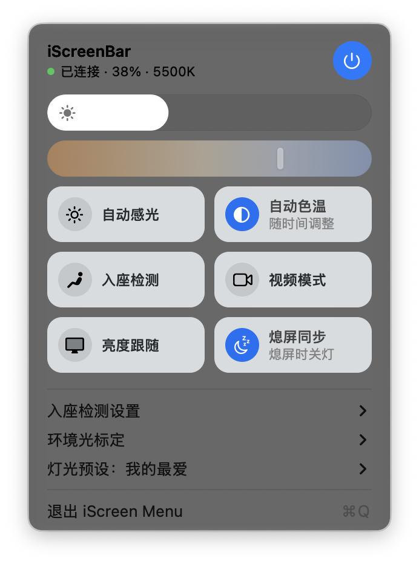
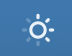

# iScreen Menu
**BenQ iScreenBar control from the macOS menu bar: brightness, colour temperature, auto light, plus Studio Display sleep sync and brightness follow.**

 

This repository is a fork of [rogerbush007-a11y/iScreenBar-StudioDisplay-Sync](https://github.com/rogerbush007-a11y/iScreenBar-StudioDisplay-Sync). It keeps only the lamp-related features and has a redesigned menu. It is an unofficial, independent project, not affiliated with BenQ or Apple, and released under the MIT licence.

The interface is in English, with Simplified Chinese, Traditional Chinese, Japanese and Korean translations that follow your preferred macOS language. Simplified Chinese labels are shown in parentheses below.

## Changes in this fork

- **Localized UI**: English, Simplified Chinese, Traditional Chinese, Japanese and Korean, following your macOS language; previously the interface was Chinese only.
- **Native menu**: the popover is replaced by a standard macOS menu, with the lamp panel at the top, native submenus below and Quit (⌘Q). It follows light and dark mode.
- **Lamp features only**: removed the built-in display switch and rotation, rotation presets, the Studio Display black overlay, keep-awake, the MacBook ↔ Studio Display brightness lock, and sleeping the displays on lock. The app no longer asks for an administrator password.
- **Menu bar icon**: a monochrome ring with 8 rays that light up with brightness; a small dot appears at the bottom right when there is a sync problem.
- **Studio Display detection**: besides model 0xAE46, model 0xAE3A and any screen named "Studio Display" are recognised. Previously some Studio Displays were not detected, so sleep sync and brightness follow silently did nothing.
- **Adjust while the lamp is off**: changing brightness, colour temperature or auto light, or applying a light preset, turns the lamp on first and then applies the change (the firmware ignores these commands while the lamp is off).
- **Reliability**: sync and status updates keep running while the menu is open; choosing Quit keeps the app closed (the LaunchAgent only restarts it after a crash); the minimum system version is declared as macOS 14.

## Interface and features

See the [UI guide](docs/UI-GUIDE.md) and the [full feature list](docs/FEATURES.md).

| Area | What it does |
| --- | --- |
| Header | Connection status, current brightness and colour temperature; the round button on the right turns the lamp on or off |
| Sliders | Brightness and 2700–6500K colour temperature. The brightness slider is disabled while Auto Light is on; the colour slider is disabled while Auto Color is on |
| Toggles | Auto Light (自动感光), Auto Color (自动色温), Presence (入座检测), Video Mode (视频模式), Follow Display (亮度跟随), Sleep Sync (熄屏同步) |
| Submenus | Presence settings (away time, sensitivity), Ambient light calibration, Light presets and Mode Center |

The app has no Dock icon. Hover over the menu bar icon to see brightness and colour temperature.

## Installation

Tested on Apple Silicon Macs with macOS 26–27, Apple Studio Display and BenQ iScreenBar (USB VID 0x04A5 / PID 0x2501). Other systems and devices have not been fully verified. Requires macOS 14 or later.

Install the Xcode Command Line Tools, then run:

```bash
xcode-select --install
git clone https://github.com/alexcding/iScreenBar-StudioDisplay-Sync.git
cd iScreenBar-StudioDisplay-Sync
./scripts/install.sh
```

The script compiles locally, signs ad hoc, installs to `~/Applications/iScreen Menu.app` and creates a per-user LaunchAgent so the app starts at login. Neither installing nor using the app needs an administrator password.

Lamp control talks to the lamp directly over USB HID and does not depend on the official app. Avoid running two programs that both write lamp settings automatically. Camera-triggered video mode and the lamp's hardware memory are not fully matched, so this is not a complete replacement for every feature of the official app.

## Behaviour

- Follow Display and the lamp's own auto light are mutually exclusive; turning follow off keeps the current brightness.
- With Sleep Sync on, the lamp turns off when the Studio Display sleeps. To keep the light on while the display sleeps, turn Sleep Sync off.
- Ambient light uses the median of the last 10 seconds. Turning off at the bright threshold takes about 30 s, turning on at the dark threshold about 30 s, and the gradual turn-on after an ambient turn-off about 45 s. Hysteresis and minimum durations apply, so crossing a value does not switch immediately. While an ambient rule is holding the lamp off, moving a slider does not turn it back on.

## Verification and limitations

```bash
./scripts/check.sh
tail -f ~/Library/Logs/iScreenBarStudioSync.log
launchctl print gui/$(id -u)/local.qiu.iScreenBarStudioSync
```

Reading the Studio Display brightness uses the private macOS DisplayServices framework, so re-test after system updates. The USB reports are specific to this lamp model; other ScreenBar models are not guaranteed to work. A successful build or status read-back does not prove the lamp is actually lit.

## Uninstall and development

```bash
./scripts/uninstall.sh
# Build only, without installing:
./scripts/build.sh
```

Uninstalling moves the app and the LaunchAgent to the Trash and keeps the log. The build output is `build/iScreen Menu.app`. Builds are signed ad hoc on your Mac; there is no Developer ID notarisation or auto-update.

The source makes no network requests and has no analytics or cloud dependencies. See [Security](SECURITY.md), [Trademark notice](NOTICE.md) and the [MIT licence](LICENSE).
